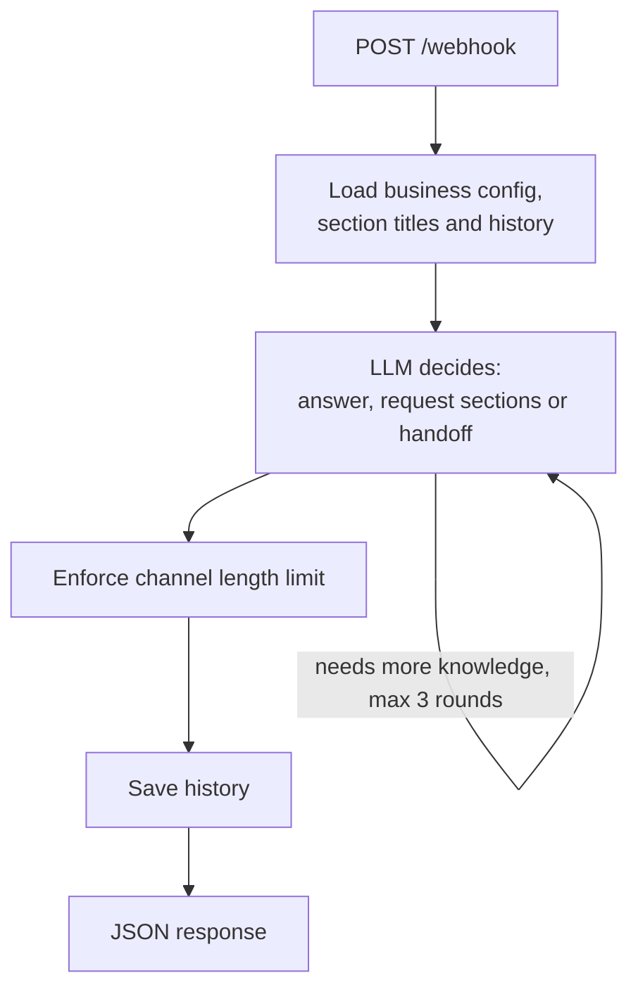

# Business AI Chatbot

Multi-tenant AI chatbot backend for small businesses. One AWS Lambda serves many
businesses; each business brings its own system prompt, knowledge base, images and
handoff messages, all stored in DynamoDB. The bot answers customer questions on
WhatsApp, Telegram and website chat, and hands the conversation to a human when asked.

Built as a freelance project for small-business clients (for example a tourism agency)
and running in production.

## How It Works

A channel router (a chat platform or a WhatsApp gateway such as SendPulse) forwards each
customer message to `POST /webhook`. The reply is returned as JSON for the router to send.



The flow is a [LangGraph](https://github.com/langchain-ai/langgraph) state graph
(`src/services/bot_graph_service.py`).

### Retrieval

The knowledge base is a set of titled sections per business. The model chooses what it needs:

1. It first sees only the section **titles** plus the conversation.
2. It either answers, requests sections by number, or hands off.
3. Requested sections are loaded and offered again, up to **three rounds**. After that the
   model must answer or hand off using what it has.

This keeps prompts small, makes retrieval easy to inspect (the log shows which sections
were requested), and lets non-technical owners maintain the knowledge as plain text.

### Structured decisions

Every model turn returns one JSON decision:

| `mode` | Meaning |
|---|---|
| `answer` | Reply text plus optional image ids (max 3, only ids from the business catalog) |
| `request_sections` | Section numbers to load before answering |
| `handoff` | Customer wants a human; the model reports the customer's language |

The response schema is generated from Pydantic models and passed to the provider as a
JSON schema (strict mode for OpenAI). The output is validated again in code, with these guards:

- Unknown section numbers and image ids are dropped.
- Ambiguous output, such as several concatenated decisions, is rejected rather than guessed at.
- Invalid output triggers one repair call; if that fails too, the customer gets a safe fallback message.

### Human handoff

On `handoff` the bot replies with a configurable message in the customer's language (with an
English fallback) and returns `branch: "handoff"`, so the router can notify the team and pause
the bot. Businesses can run in a demo mode with explanatory handoff texts.

### Channel limits and length control

Each channel has a reply limit (WhatsApp 500, Telegram and website widget 1000 characters).
The limit is part of the system prompt. If the answer is still too long, the model rewrites
it once, and as a last resort the text is truncated.

### Conversation memory

Turns are stored in DynamoDB per business and user. The last 12 turns go to the model and
up to 30 are kept in storage (`WINDOW_TURNS` overrides both).

## API

`GET /` returns a health check.

`POST /webhook` checks the header `X-Webhook-Secret` against `WEBHOOK_SECRET` when one is configured.

```json
{
  "business_id": "demo-shop",
  "user_id": "customer-123",
  "message_text": "Do you ship to Austria?",
  "channel": "whatsapp"
}
```

Response:

```json
{
  "ok": true,
  "branch": "reply_text",
  "channel": "whatsapp",
  "max_reply_chars": 500,
  "lang": "",
  "reply_text": "Yes, we ship to Austria within 3 to 5 days.",
  "additional_reply": "Before we start ...",
  "number_images": 1,
  "image_url_1": "https://...",
  "image_url_2": "",
  "image_url_3": "",
  "echo": { "...": "request payload" }
}
```

- `branch` is `reply_text`, `handoff` or `error`.
- `additional_reply` is a separate message sent only with the **first** WhatsApp reply of a
  chat. Businesses use it for a privacy link, an AI disclaimer or attribution.

## Data Model (DynamoDB)

| Table | Content |
|---|---|
| Business config | `business_id`, `system_prompt`, `first_reply_addendum`, `handoff_message` per language, `demo` flag |
| Knowledge sections | per business: `section_id`, `title`, `text` |
| Image catalog | per business: `image_id`, `url` |
| History | `chat_key` (`business_id#user_id`), `ts`, `role`, `text` |

Everything a business owner can change lives in these tables, so prompts and knowledge are
updated without a deployment. They are managed through a separate admin app that is not part
of this repository.

## Model Providers

`ModelProvider` has two implementations, selected with `MODEL_PROVIDER` (`openai` by default,
or `gemini`):

- OpenAI via Chat Completions with a strict JSON schema (`OPENAI_MODEL`, default `gpt-5.4-mini`)
- Gemini via `google-genai` with a JSON response schema (`GEMINI_MODEL`, default `gemini-2.5-flash`)

## Configuration

Environment variables:

| Variable | Purpose |
|---|---|
| `BUSINESS_CONFIG_TABLE_NAME`, `KNOWLEDGE_SECTIONS_TABLE_NAME`, `IMAGE_CATALOG_TABLE_NAME`, `HISTORY_TABLE_NAME` | DynamoDB tables |
| `MODEL_PROVIDER`, `OPENAI_MODEL`, `GEMINI_MODEL` | Model selection |
| `WINDOW_TURNS` | History window (default 12 for the model, pruning keeps 30 unless set) |
| `SECRETS_ARN` | AWS Secrets Manager secret holding the keys below |
| `LOG_LEVEL` | Logging level (default `INFO`) |

Secrets, read at runtime from one Secrets Manager secret (JSON): `WEBHOOK_SECRET`,
`OPENAI_API_KEY`, `GEMINI_API_KEY`. Nothing secret lives in the repository or in environment variables.

## Privacy

Customer messages, model answers and prompts are never written to the logs. They contain
business and user ids, decisions, requested section numbers and titles, and **character counts**.

## Scope

This is a deliberately simple design: LLM-routed retrieval over structured sections, no vector
store and no tool calling. Integrations such as booking or availability lookups have been built
for clients on their own infrastructure and are not part of this repository.

## Development

```bash
pip install -r requirements.txt pytest
pytest
```

The tests need no AWS access: `tests/conftest.py` sets dummy table names and credentials,
and the graph tests replace the model and the data layer. They cover the decision loop
(section rounds, handoff, error paths), length repair and truncation, channel policy,
handoff message resolution, history handling, the knowledge services and the log helper.

## Deployment

`./deploy.sh dev|prod` installs Linux wheels, zips the source, uploads it to S3 and updates
the Lambda (FastAPI wrapped with Mangum, Python 3.12). It expects an AWS CLI profile named
`personal`.

## Project Layout

```text
src/
  main.py                      FastAPI app and webhook
  ai/                          model providers (OpenAI, Gemini)
  services/
    bot_graph_service.py       LangGraph flow
    knowledge_selection_service.py   decision prompt, schema, parsing and repair
    reply_length_service.py    limits, shortening, truncation
    channel_policy_service.py  per-channel limits
    handoff_message_service.py handoff texts
    history_service.py         conversation window
  repository/                  DynamoDB access
tests/
```
